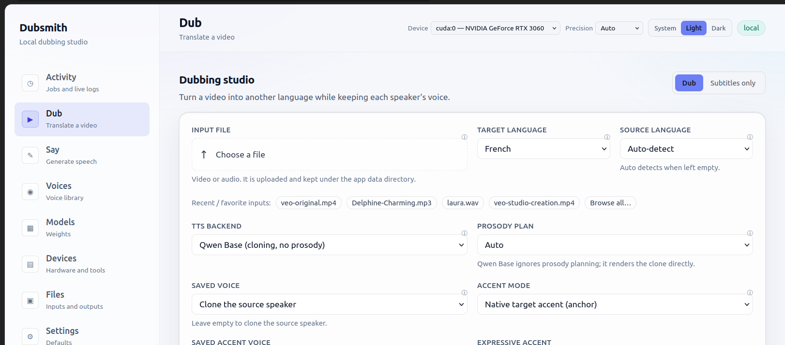

# Dubsmith — AI dubbing + expressive voice generation

**Keep the voice. Change the language.**

Dub a video into another language while keeping each speaker's **own voice
timbre** — in a local browser app or from the terminal. Or generate speech in a
saved or designed voice with per-line emotion. The models run locally; the only
network call is the configured OpenAI-compatible LLM endpoint, which can be
local or cloud.

[](https://github.com/tamanois/dubsmith/actions/workflows/ci.yml)
[](LICENSE)
[](pyproject.toml)

[Documentation](docs/README.md) · [Roadmap](PLAN.md) · [Contributing](CONTRIBUTING.md) · [Model licenses](docs/model-licenses.md) · [Engineering guidelines](docs/development/guidelines.md)


**Before / after** — same speaker and timing, English → French, voice cloned from
the speaker's own audio.
[Source clip](docs/media/demo-before.mp4) · [Dubbed clip](docs/media/demo-after.mp4) ·
[How it was made](docs/media/README.md)

---

## Two ways to use it

| | Browser app | Terminal |
|---|---|---|
| Start it | `dub-server`, then open <http://127.0.0.1:8000> | `dub --video talk.mp4 --target fr` |
| Best for | choosing options without remembering flags, and watching a run | scripting, servers, batch work |
| Same job | every form maps onto one option and the same `pipeline/` call | the same operations, one command each |



**The Dub page** — upload or pick a recent clip, choose the target language, and
leave the rest alone; the technical knobs sit under *Advanced options*, and a
control the selected backend cannot honour is disabled with the reason printed
underneath. The header carries the default device, precision and theme.

Both surfaces call the same code, so the same options produce the same
artifacts. Job history with retry, edit, compare and download — plus saved
presets and recent inputs — exist in the app only; the terminal prints the log
and the output paths.

The app is one local process (FastAPI + SQLite + a worker) serving a React
single-page UI. Jobs run one at a time, stream stage and log lines over SSE, and
write to a unique folder per run so nothing is overwritten. Every page has its
own address (`#/dub`, `#/activity`, …). It is single-user and unauthenticated by
design: keep it on `127.0.0.1`, or put authentication in front of it.

## What it does

| Mode | What you get | Where |
|---|---|---|
| **Video dubbing** | detect the language, separate speakers, clone each voice, translate, synthesise, mux. Ten target languages, native-accent anchors, background and room preservation, multi-speaker support | app + terminal |
| **Subtitles only** | ASR + translation + SRT, soft-embedded or burned in. No TTS model is loaded | app + terminal |
| **Speech generation** | text to speech with a saved, designed, cloned or preset voice. Translation is not involved | app + terminal |
| **Voice library** | design from a prompt, clone from a clip, or import a clip with `voices --add`; reuse by label in `say` or a dub | app + terminal |
| **Emotion and prosody** | per line, planned by the LLM or directed by hand: CosyVoice3, Chatterbox, Fish | app + terminal |
| **Quality and provenance** | `report.json`, `prosody.json`, timestamped `provenance/`, `audit_qc.py`, `audit_timbre.py` | terminal |
| **Not included** | lip sync (P4) and multi-language source videos (P5) | — |

## Quick start

**Requirements** — Python 3.10–3.12 (`numpy==1.26.4` has no 3.13 wheels),
`ffmpeg`/`ffprobe` for video input (audio-only needs neither), ~10 GB of disk for
the core weights, and an **OpenAI-compatible** LLM endpoint for translation. A
GPU is optional but strongly recommended (~12 GB VRAM for the default path).

**1. Clone, install, point at a model**

```bash
git clone https://github.com/tamanois/dubsmith.git
cd dubsmith
python3 -m venv .venv
source .venv/bin/activate
pip install ".[web]"      # runtime + FastAPI/uvicorn for the browser app
cp .env.example .env
```

```dotenv
LLM_BASE_URL=http://127.0.0.1:8080/v1
LLM_API_KEY=not-needed
LLM_MODEL=local-model
```

Any OpenAI-compatible server works, including a local `llama.cpp`:
`llama-server -m /path/to/model.gguf --port 8080`.

**2. Download the models (~10 GB, once)**

```bash
python dub.py models --download all
```

**3. Open the app**

```bash
cd web && npm install && npm run build && cd ..   # build the UI once
dub-server                                        # http://127.0.0.1:8000
```

Upload a video on **Dub**, choose the target language, and press **Start
dubbing**. Progress, the log and the finished files are on **Activity**.
`DUB_HOST`, `DUB_PORT`, `DUB_DATA_DIR` and `DUB_OUTPUT_DIR` override the
defaults.

**Or stay in the terminal**

```bash
python dub.py devices                        # every GPU, its VRAM, the flag to use
python dub.py --video talk.mp4 --target fr   # dubbed video + soft subtitles
```

Either path writes `talk_dubbed.mp4` (or `talk_dubbed.wav` for audio input) with
subtitles and `report.json` beside it. A first run also generates the French
accent anchor, cached under `models/anchors/`.

Optional extras, each degrading gracefully when absent:

```bash
pip install ".[full]"     # Demucs background separation, funasr diarization, SpeechBrain overlap
```

For the full setup matrix — CPU-only installs, CUDA 12 libraries for GPU ASR,
optional expressive backends, macOS notes, `MODELS_DIR` — see
[Getting started](docs/getting-started.md). Prefer containers? The repository
ships an optional `Dockerfile` with every dependency (models excluded); the same
page has the build and run commands.

## Main commands

```bash
# dubbing
python dub.py --video talk.mp4 --target fr          # dubbed video + soft subtitles
python dub.py --audio interview.wav --target es     # audio only, no ffmpeg
python dub.py --video talk.mp4 --target de --source en
python dub.py --video talk.mp4 --target fr --subtitles-mode burn   # burn into frames

# one voice per speaker, and both voices of an overlap
python dub.py --video debate.mp4 --target fr --overlap separate

# expressive dubbing: the LLM plans every translated line
python dub.py --video talk.mp4 --target fr --backend chatterbox --prosody-plan auto
python dub.py --video talk.mp4 --target fr --backend fish --expressive-accent blend

# subtitles without dubbing
python dub.py subtitles --video talk.mp4 --target fr

# voices, then standalone speech
python dub.py voices --design --prompt "a warm female French voice" --lang fr --label warm-fr
python dub.py voices --add me.wav --transcribe --label me
python dub.py say --voice warm-fr --text "Bonjour, ceci est un test."
python dub.py say --voice warm-fr --backend cosyvoice3 --text "…" \
  --prosody "emotion=happy, pace=fast, breath"

# inspect a finished run
python dub.py info
python audit_qc.py "output/talk" --timbre
```

`qwen` (the default) clones the voice but has no prosody channel; pick
`cosyvoice3`, `chatterbox` or `fish` for per-line emotion. `customvoice` is
speech generation only. For dubbing, `--prosody-plan auto` plans when the LLM is
reachable and falls back to neutral; `off` is neutral; `llm` fails without the
endpoint.

The command-by-command chooser and worked examples are in
[Usage](docs/usage.md); the backend table, accent modes and prosody values are in
[Voices](docs/voices.md); every flag, default and HTTP route is in
[Reference](docs/reference.md). `python dub.py --help` prints the same flags.

## Tests

The suite needs no GPU, downloaded models or ffmpeg — heavy components are faked.

```bash
pip install -r requirements-dev.txt
python -m pytest
cd web && npm test && npm run build
```

The quality tools (`audit_qc.py`, `audit_timbre.py`) and the gates they enforce
are covered in
[Outputs and caching](docs/outputs-and-caching.md#judging-a-run).

## Documentation

- [Getting started](docs/getting-started.md) — install natively or with Docker, download the models, configure the LLM, add optional backends
- [Usage](docs/usage.md) — the browser app page by page, then the CLI command chooser and worked examples
- [Reference](docs/reference.md) — every flag, default, environment variable and HTTP route
- [Voices](docs/voices.md) — the voice library, cloning, accent modes, emotion and `dub say`
- [Dubbing quality](docs/dub-quality.md) — speakers, overlapping speech, timing, room and loudness
- [Performance](docs/performance.md) — device and precision, several GPUs, long videos
- [Outputs and caching](docs/outputs-and-caching.md) — artifacts, `report.json`, the stage cache, the audit tools
- [Troubleshooting](docs/troubleshooting.md) — errors in the app and the CLI, logs, limits

The [documentation index](docs/README.md) adds model licenses, the development
guide and a reading path for each kind of reader.

---

## License and responsible use

- **Code**: Apache-2.0; see [LICENSE](LICENSE) and [NOTICE](NOTICE).
- **Docs**: CC BY 4.0 unless a file says otherwise; see
  [docs/LICENSE.md](docs/LICENSE.md).
- **Model weights are separate.** Qwen3-TTS and Whisper are Apache-2.0 / MIT;
  CosyVoice3 is Apache-2.0; Chatterbox is MIT; **Fish S2-Pro is
  non-commercial**. The default path does not use Fish. See
  [docs/model-licenses.md](docs/model-licenses.md) and
  [THIRD_PARTY_LICENSES.md](THIRD_PARTY_LICENSES.md).
- **Consent**: clone only voices you have permission to use. Voice is biometric
  data under GDPR, and synthetic-dubbing disclosure is increasingly required.
- **Privacy**: there is no telemetry. Job artifacts contain transcripts and can
  contain reference audio; `voices/`, `input/`, `output/`, `data/` and `models/`
  are gitignored. Translation and optional prosody planning send text to the
  configured OpenAI-compatible LLM endpoint.
- **Known gaps** are tracked in [PLAN.md](PLAN.md): lip sync, multi-language
  source videos, and iterative length control in the translation loop.
