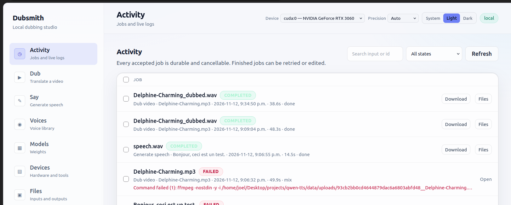

# Usage

Two surfaces, one pipeline: a local browser app for choosing options without
remembering flags, and a command line for scripting. Every option exists in
both, and both write the same artifacts. Full flag, environment-variable and
HTTP-route tables are in [Reference](reference.md).

## The app

Start it once with `dub-server` and open <http://127.0.0.1:8000> — the install
and the `DUB_*` variables are in
[Getting started → Start the app](getting-started.md#start-the-app).

Every screen has its own address, so a view can be bookmarked, shared or
reached with the browser's back button: `#/activity`, `#/dub`, `#/say`,
`#/voices`, `#/models`, `#/devices`, `#/files`, `#/settings`.

| Page | What it is for |
|---|---|
| **Activity** | every job, with its output file as the title and the operation as the subtitle; filter by state, search, paginate, and bulk-clear finished records |
| **Dub** | the dubbing form: input, target and source language, backend, prosody plan, voice, accent mode, then **Advanced options** |
| **Subtitles only** | the same input and language flow without TTS; the mode switch is in the Dub header |
| **Say** | speech generation from a saved, designed or cloned voice, or a CustomVoice preset speaker |
| **Voices** | design, clone, register, audition, paginate and delete library voices |
| **Models** | status, downloads (MVP set, one model, or everything) and deletion behind a confirmation that reports the freed space |
| **Devices** | detected hardware, precision, optional packages and system binaries |
| **Files** | generated outputs first, then uploads: inline playback, path copy, per-run details, download, bulk delete |
| **Settings** | LLM endpoint/model/timeouts, audio defaults, storage, logging, default device and precision, JSON export/import |



**Activity** — each run keeps the name of its deliverable, its input, its start
time, its duration and its state. A failure prints the failing command and its
error inline; a finished job offers **Download**, **Files**, **Retry** and
**Edit**, and the checkbox column clears finished records in bulk.

### How a job runs

Submitting returns immediately with a job id. The states are `QUEUED`,
`PROCESSING`, `COMPLETED`, `FAILED` and `CANCELLED`, one heavy job runs at a
time, and the queue is bounded: excess work is rejected with a message rather
than silently queued. Stage changes, log lines and the final result stream over
SSE; if the stream drops, the page reconnects and resumes from the last event,
and plain HTTP state keeps working meanwhile, so **Cancel** still succeeds.

Progress is real stage state — the app never invents a percentage. The log opens
by itself while a job is queued or running and starts collapsed once it is
finished, but a log you opened stays open. A finished job can be **retried** in a
fresh folder (the original is untouched), **edited** with every stored option
prefilled, **downloaded**, or **compared** against its source.

### Choosing options without guessing

Each field carries a tooltip. The few choices most people make stay visible; the
technical knobs are under **Advanced options**, grouped by topic (accent blend,
backend tuning, audio and subtitles, timing and speakers, models and hardware).

Options the selected backend cannot honour are disabled with the reason printed
underneath, and their values are dropped from the request — switching from
Chatterbox to Qwen Base cannot send a stale prosody line. Combinations that span
several fields block **Submit** and explain themselves above it: source equal to
target language, a reference clip in *keep the speaker's accent* mode without a
transcript, *borrow a reference accent* with neither a clip nor a saved accent
voice, accent matching outside native mode, or no voice source at all on the Say
form. The server validates the same rules and answers `422` with the same
message, so bypassing the form does not help.

**Presets** save the form's options (not the input file) at the bottom of the
Dub and Say forms, and **recent** or **favorited** inputs make a previously used
clip one click away.

### Where the files go

Each job gets its own folder under `DUB_OUTPUT_DIR`:

```text
<stem>__<operation>__<language>__<run-id>/
```

The pipeline writes its normal artifacts inside it, so two runs never overwrite
each other, and the main deliverable keeps the input's name (`talk_dubbed.mp4`,
`talk_dubbed.wav`, `talk_subtitled.mp4`). **Files** lists them one row per run;
**Details** reveals every artifact in that run. Uploads are stored under the app
data directory and can be reused by later jobs.

### What the app does not do

It is local and single-user: no accounts, no authentication, no remote workers,
and one job at a time. Keep it bound to `127.0.0.1`, or put authentication in
front of it before exposing it. Uploads must come through the app or already
live under `input/`, `output/` or the app data directory; arbitrary filesystem
paths are rejected, and the API's own security boundaries are listed in
[Reference → HTTP API](reference.md#http-api).

## The command line

### Which command do I want?

| If you want… | Use | What it changes |
|---|---|---|
| a first working dub, zero setup | `--video talk.mp4 --target fr` | detects the source language, picks the donor voice from the video, borrows a generated native accent, preserves the original music/ambience |
| a voice that isn't the video's speaker | `--ref-audio ref.wav --ref-text "…"` | clones `ref.wav` for both timbre and accent |
| a reusable voice from a text description | `python dub.py voices --design --prompt "…" --lang fr` | saves a labeled voice you can reuse by name — see [Voice library](voices.md#voice-library-saved-voices) |
| a reusable voice from a clip you already have | `python dub.py voices --add me.wav --transcribe` | registers the clip as-is, no model or GPU involved; `--clone` encodes it once instead |
| to use a saved voice for a dub | `--voice warm-fr` | timbre from the saved voice, including its stored encoding; accent still follows `--accent-mode` |
| to speak text with a saved or inline voice | `python dub.py say --voice warm-fr --text "…"` | standalone speech synthesis — no video, no translation |
| emotional delivery in a dub | `--backend chatterbox --prosody-plan auto` | plans per-line emotion for the translated lines; `off` is neutral, `llm` requires the endpoint |
| emotional delivery in `say` | `--backend cosyvoice3 --prosody "emotion=happy, breath"` | manual per-line prosody; `--prosody-plan llm` plans it instead |
| an anchor fitted to the source voice | `--accent-match rate` (or `gender`) | generates a per-speaker anchor matching the speaker's rate (and gender) |
| to keep the source accent | `--accent-mode preserve` | clones the speaker's accent along with their voice |
| to drop the source accent using the model's own phonetics | `--accent-mode speaker-only` | keeps the timbre, lets the model choose target-language phonetics |
| a native accent you choose yourself | `--accent-mode reference-accent --accent-audio nat.wav --accent-text "…"` | timbre from the video's speaker, pronunciation from `nat.wav` |
| the same accent from a saved voice | `--accent-mode reference-accent --accent-voice deep-fr` | the saved voice supplies the clip and its exact transcript, no flags repeated |
| every speaker in their own voice | *nothing* | finds the speakers and clones each one from their own voice — see [Dubbing a video with several speakers](dub-quality.md#dubbing-a-video-with-several-speakers) |
| one voice for the whole video | `--diarizer none` | the pre-P1 behaviour: whichever speaker talks most supplies the voice |
| no music behind the voice | `--no-background` | discards the separated bed instead of ducking it |
| an absolute loudness target | `--loudness lufs --lufs -16` | forces a level instead of matching the source |
| to redo a run from scratch | `--force` | ignores the stage cache |
| to judge a run without listening | *nothing* | read `report.json` in the job folder |

Every option is described in [Reference](reference.md);
`python dub.py --help` prints the same list.

### Commands, grouped by purpose

**Set up**

```bash
python3 -m venv .venv && source .venv/bin/activate   # one-time
pip install .                                        # runtime dependencies
pip install -r requirements-dev.txt                  # + pytest and the optional backends

python dub.py info                                   # what will this machine use?
python dub.py models --download all                  # ~10 GB of weights
python dub.py models --list                          # what is present already?
```

**Dub something**

```bash
# video -> dubbed video, source language auto-detected
python dub.py --video talk.mp4 --target fr

# audio only: no ffmpeg needed, writes <input>_dubbed.wav + subtitles
python dub.py --audio interview.wav --target es

# trust your own language detection instead of Whisper's
python dub.py --video talk.mp4 --source en --target de

# skip the subtitle files
python dub.py --video talk.mp4 --target ja --no-subtitles
```

With no `--ref-audio`, the reference voice is taken automatically from the
longest clean speech segment and its transcript comes from the ASR pass, so
there is nothing to prepare by hand.

**Choose the voice**

```bash
# clone a specific recording instead of the speaker in the video
python dub.py --video talk.mp4 --target fr \
  --ref-audio "voice.wav" \
  --ref-text "the exact words spoken in voice.wav"

# keep the speaker's timbre, drop their accent
python dub.py --video talk.mp4 --target fr --accent-mode speaker-only

# keep the speaker's timbre, borrow a native accent
python dub.py --video talk.mp4 --target fr \
  --accent-mode reference-accent \
  --accent-audio "native.wav" \
  --accent-text "the exact words spoken in native.wav"
```

Any format `libsndfile` reads works for reference and accent clips:
`.wav` `.flac` `.mp3` `.ogg` `.aiff`, a URL, or a `(samples, rate)` tuple.
`--ref-text` must be the **exact transcript** of `--ref-audio` because the model
conditions on both (ICL mode); the same is true of `--accent-text` for
`--accent-audio`. See [Accent modes](voices.md#accent-modes) for which mode needs which.

**Control the audio bed and level**

```bash
python dub.py --video talk.mp4 --target fr --no-background    # voice only
python dub.py --video talk.mp4 --target fr --duck-db 10       # bury the music further
python dub.py --video talk.mp4 --target fr --separator none   # treat the source as one track
python dub.py --video talk.mp4 --target fr --loudness lufs --lufs -16
```

**Control timing**

```bash
python dub.py --video talk.mp4 --target fr --min-stretch 0.70   # permit faster speech than the default
python dub.py --video talk.mp4 --target fr --budget-speedup 0.90 # fit more words per line
python dub.py --video talk.mp4 --target fr --max-stretch 1.10  # cap how far lines are slowed
python dub.py --video talk.mp4 --target fr --stretcher sox     # pick a specific backend
```

**Repeatable and diagnostic runs**

```bash
python dub.py --video talk.mp4 --target fr --force     # ignore the cache
python dub.py --video talk.mp4 --target fr -v          # debug logging
python dub.py --video talk.mp4 --target fr --device cpu # rule the GPU out
```

### Fast iteration

A 5-minute video takes a few minutes to dub, which is slow to iterate on. Slice
out a short section and dub that instead — the pipeline behaves identically,
just faster:

```bash
ffmpeg -ss 30 -t 60 -i talk.mp4 -c copy clip60.mp4
python dub.py --video clip60.mp4 --target fr
```

Note that `-c copy` cuts on the nearest keyframe, so `clip60.mp4` may start a
second or two earlier than requested. That is fine for trying out options.

### Verified commands

These were all run on a 4:47 English TED talk → French, on 2× RTX 3060. The
figures come from each run's `report.json`.

| Command | Result |
|---|---|
| `--video talk.mp4 --target fr` | 11.4 s of speech trimmed; sync exact; background preserved |
| `--video talk.mp4 --target fr --ref-audio slow.wav --ref-text "…"` | 23.0 s trimmed — the slow reference lengthened every line |
| `--video talk.mp4 --target fr --accent-mode speaker-only` | timbre 0.9876, French fit −0.081 |
| `--video talk.mp4 --target fr --accent-mode reference-accent --accent-audio slow.wav --accent-text "…"` | timbre 0.9854, French fit −0.057, 13.4 s trimmed |
| `--video talk.mp4 --target fr --accent-mode reference-accent --accent-audio fast.mp3 --accent-text "…"` | **best overall**: 2.3 s trimmed, 0 drift, loudness matched, background preserved |
| `--video talk.mp4 --target fr --accent-mode reference-accent --accent-audio fast.mp3 --accent-text "…" --refine` (default) | **best overall**: 0.0 s trimmed, 3 lines rewritten, worst-line deletion 59% → 0%, WER 1.5% → 1.2% |
| `--video debate.mp4 --target fr --accent-mode reference-accent …` (two speakers, 60 s) | 2 voices found (7 and 8 lines), each with its own donor and its own blend clip; 0 of 15 lines closer to the accent voice on the per-speaker audit |

The last row is the configuration to aim for: a fast-paced native clip as the
accent source gives near-native pronunciation with almost no speech lost. Full
run takes about 2 minutes 45 seconds.

The timing knobs were measured on a longer, harder job: an 11-minute English →
French video with two speakers (a local test clip, not distributed with the
repo), where the source talks at 4.7 words/s and the French clone delivers 3.6.
`--max-overrun` is the knob that
decides whether a line that still does not fit loses its tail or starts late:

| Command | Result |
|---|---|
| `--video long.mp4 --target fr` (defaults) | **run**: 4.69 s of speech deleted across **31** lines; lateness bounded at `shifted_seconds_max` 0.25 s; synthesis 461 s; `audit_qc.py` passes sync |
| `… --max-overrun 0` | **simulated** on the same job's fitted durations: 8.90 s deleted across 66 lines, every line exactly on its source time |
| `… --max-overrun 0.75` | **simulated** on the same durations: 0.40 s deleted across 4 lines, worst line 0.75 s late (`audit_qc.py --max-shift 0.75` accepts it) |

The simulations are the same model that reproduced the run's own 0.25 s result to
the line (31 lines, 4.67 s predicted against 31 and 4.69 s measured), which is why
they are quoted — but they are predictions, not runs. The full curve is in
[When a translation is too long for its slot](dub-quality.md#when-a-translation-is-too-long-for-its-slot).

---

Next: [Voices](voices.md) for the voice library and accent modes, or
[Reference](reference.md) for every flag, default and endpoint.
